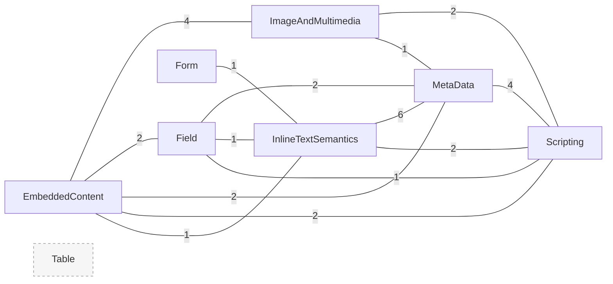
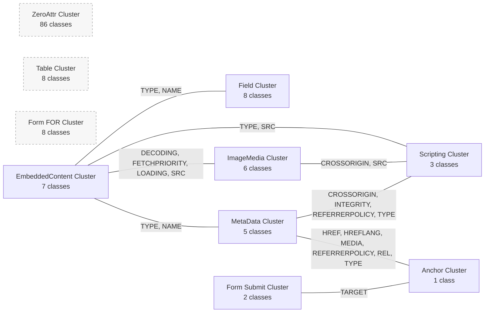

# AX Element Attribute Overlap Map

## Purpose

This document inventories non-global opening-tag attribute overlap across all concrete Element classes.

- Scope: concrete classes under `src/MvpLounge/MeshFactory/Element/`
- Baseline excluded from overlap math: global attributes from `FactoryAbstract::$FactoryElementAttributes`
- Overlap source: effective `AllowedFactoryElementAttributes` on each concrete class, including inherited abstract-chain attributes

## Snapshot

- Concrete classes scanned: `134`
- Domains scanned: `17`
- Unique non-global attributes observed: `42`
- Attributes used by more than one concrete class: `41`

## Domain Attribute Inventory

Only domains with non-global attribute ownership are listed below.

| Domain | Class Count | Non-Global Attribute Count | Attributes |
|---|---:|---:|---|
| EmbeddedContent | 7 | 6 | `DECODING`, `FETCHPRIORITY`, `LOADING`, `NAME`, `SRC`, `TYPE` |
| Field | 8 | 7 | `ACCESS`, `CHECKED`, `NAME`, `PLACEHOLDER`, `SELECTED`, `TYPE`, `VALUE` |
| Form | 10 | 7 | `ACTION`, `AUTOCOMPLETE`, `ENCTYPE`, `FOR`, `METHOD`, `NOVALIDATE`, `TARGET` |
| ImageAndMultimedia | 6 | 12 | `ALT`, `AUTOPLAY`, `CONTROLS`, `CROSSORIGIN`, `DECODING`, `FETCHPRIORITY`, `LOADING`, `LOOP`, `MUTED`, `POSTER`, `PRELOAD`, `SRC` |
| InlineTextSemantics | 32 | 8 | `HREF`, `HREFLANG`, `MEDIA`, `PING`, `REFERRERPOLICY`, `REL`, `TARGET`, `TYPE` |
| MetaData | 5 | 10 | `AS`, `CROSSORIGIN`, `HREF`, `HREFLANG`, `INTEGRITY`, `MEDIA`, `NAME`, `REFERRERPOLICY`, `REL`, `TYPE` |
| Scripting | 3 | 5 | `CROSSORIGIN`, `INTEGRITY`, `REFERRERPOLICY`, `SRC`, `TYPE` |
| Table | 8 | 8 | `ABBR`, `BORDER`, `CELLPADDING`, `CELLSPACING`, `COLSPAN`, `HEADERS`, `ROWSPAN`, `SCOPE` |

## Highest Overlap Attributes

| Attribute | Concrete Classes | Domains | Notes |
|---|---:|---:|---|
| `TYPE` | 24 | 5 | Broadest cross-domain overlap |
| `NAME` | 20 | 3 | Shared by EmbeddedContent, Field, MetaData |
| `SRC` | 16 | 3 | Shared by EmbeddedContent, ImageAndMultimedia, Scripting |
| `CROSSORIGIN` | 14 | 3 | Shared by ImageAndMultimedia, MetaData, Scripting |
| `DECODING` | 13 | 2 | EmbeddedContent + ImageAndMultimedia |
| `FETCHPRIORITY` | 13 | 2 | EmbeddedContent + ImageAndMultimedia |
| `LOADING` | 13 | 2 | EmbeddedContent + ImageAndMultimedia |
| `REFERRERPOLICY` | 9 | 3 | InlineTextSemantics + MetaData + Scripting |

## Pairwise Domain Overlap

These are non-zero domain intersections.

| Domain A | Domain B | Shared Count | Shared Attributes |
|---|---|---:|---|
| InlineTextSemantics | MetaData | 6 | `HREF`, `HREFLANG`, `MEDIA`, `REFERRERPOLICY`, `REL`, `TYPE` |
| EmbeddedContent | ImageAndMultimedia | 4 | `DECODING`, `FETCHPRIORITY`, `LOADING`, `SRC` |
| MetaData | Scripting | 4 | `CROSSORIGIN`, `INTEGRITY`, `REFERRERPOLICY`, `TYPE` |
| EmbeddedContent | Field | 2 | `NAME`, `TYPE` |
| EmbeddedContent | MetaData | 2 | `NAME`, `TYPE` |
| EmbeddedContent | Scripting | 2 | `SRC`, `TYPE` |
| Field | MetaData | 2 | `NAME`, `TYPE` |
| ImageAndMultimedia | Scripting | 2 | `CROSSORIGIN`, `SRC` |
| InlineTextSemantics | Scripting | 2 | `REFERRERPOLICY`, `TYPE` |
| EmbeddedContent | InlineTextSemantics | 1 | `TYPE` |
| Field | InlineTextSemantics | 1 | `TYPE` |
| Field | Scripting | 1 | `TYPE` |
| Form | InlineTextSemantics | 1 | `TARGET` |
| ImageAndMultimedia | MetaData | 1 | `CROSSORIGIN` |

## Overlap Diagram

Interpretation:

- Higher edge labels mean stronger shared attribute contracts between domains.
- `Table` is isolated from other domains at the non-global level in this snapshot.
- `InlineTextSemantics`, `MetaData`, and `Scripting` form one overlap cluster.
- `EmbeddedContent` and `ImageAndMultimedia` form another overlap cluster.

## Class Signature Clusters

Class clusters below are grouped by identical effective non-global attribute signatures.

| Cluster | Classes | Domain(s) | Attribute Signature |
|---|---:|---|---|
| Zero-attribute baseline | 86 | DemarcatingEdits, InlineTextSemantics, InteractiveElements, ObsoleteAndDeprecated, Root, SectioningContent, SvgAndMathMl, TableContent, TextContent, WebComponents | none |
| Table attribute family | 8 | Table | `ABBR`, `BORDER`, `CELLPADDING`, `CELLSPACING`, `COLSPAN`, `HEADERS`, `ROWSPAN`, `SCOPE` |
| Field input family | 8 | Field | `ACCESS`, `CHECKED`, `NAME`, `PLACEHOLDER`, `SELECTED`, `TYPE`, `VALUE` |
| Form-element for family | 8 | Form | `FOR` |
| Embedded-content family | 7 | EmbeddedContent | `DECODING`, `FETCHPRIORITY`, `LOADING`, `NAME`, `SRC`, `TYPE` |
| Image/multimedia family | 6 | ImageAndMultimedia | `ALT`, `AUTOPLAY`, `CONTROLS`, `CROSSORIGIN`, `DECODING`, `FETCHPRIORITY`, `LOADING`, `LOOP`, `MUTED`, `POSTER`, `PRELOAD`, `SRC` |
| Metadata family | 5 | MetaData | `AS`, `CROSSORIGIN`, `HREF`, `HREFLANG`, `INTEGRITY`, `MEDIA`, `NAME`, `REFERRERPOLICY`, `REL`, `TYPE` |
| Script family | 3 | Scripting | `CROSSORIGIN`, `INTEGRITY`, `REFERRERPOLICY`, `SRC`, `TYPE` |
| Form submit family | 2 | Form | `ACTION`, `AUTOCOMPLETE`, `ENCTYPE`, `METHOD`, `NOVALIDATE`, `TARGET` |
| Anchor-only family | 1 | InlineTextSemantics | `HREF`, `HREFLANG`, `MEDIA`, `PING`, `REFERRERPOLICY`, `REL`, `TARGET`, `TYPE` |

### Class Cluster Diagram

Interpretation:

- `C6` (MetaData) and `C4` (EmbeddedContent) are major bridge clusters connecting multiple families.
- `C1` (Table) and `C3` (Form FOR-only) are specialized isolated signatures.
- `C0` is the dominant baseline: classes relying only on global default attributes.

## Data Source

- Generated report: `/.tmp/json/element-attribute-overlap.json`
- Cluster report: `/.tmp/json/element-class-clusters.json`
- Generated at: `2026-10-12T20:47:51.6774328-04:00`

### Cluster Artifact Contract

`/.tmp/json/element-class-clusters.json` is the reverse-audit source for abstraction ownership and includes:

- All concrete classes under `src/MvpLounge/MeshFactory/Element/`
- Full enum universe from `FactoryElementAttribute`
- Effective attribute sets per cluster using:
    - `FactoryAbstract::$FactoryElementAttributes` (global baseline)
    - class-chain `AllowedFactoryElementAttributes`
- Attribute owner mapping (`EnumAttrOwnerMap`) to trace cluster attributes back to abstract sources
- Source-of-truth document pointers for inheritance and enum governance
