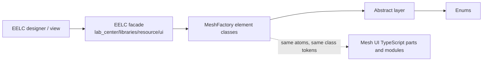
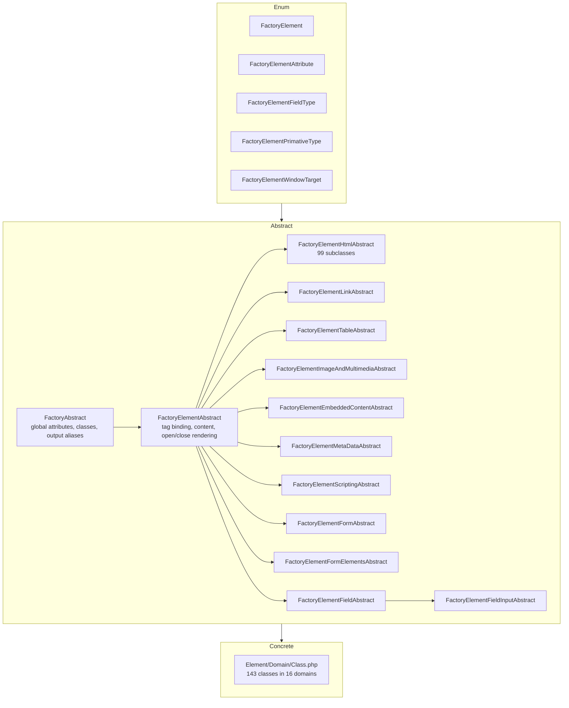

# AX ElementFactory Pattern

This is the canonical guide to the ElementFactory pattern implemented by the `MvpLounge\MeshFactory` namespace: how an element is described, built, configured, and rendered. Every output shown here was produced by running the code. Where behavior is wrong today, the example links the backlog story (for example `EF-003`) instead of hiding it.

Related documents:

- [API reference](AX-element-factory-api-reference.md): methods by layer.
- [Inventory](AX-element-factory-inventory.md): every element, its class, tier, test coverage, and TypeScript counterpart.
- [TypeScript alignment](AX-element-factory-typescript-alignment.md): mapping to the Mesh UI library.
- [Rendered output catalog](../behavior/BV-element-factory-rendered-output-catalog.md): what the sandbox renders.
- [Implementation backlog](../behavior/BV-element-factory-implementation-backlog.md): Given-When-Then stories.

## What The Pattern Is

One PHP class describes one HTML element. A class is deliberately tiny: it binds an enum value, optionally narrows the allowed attributes, and inherits everything else.

```php
class P extends FactoryElementHtmlAbstract
{
    protected array $AllowedFactoryElements = [FactoryElement::P];
    protected ?FactoryElement $FactoryElement = FactoryElement::P;
}
```

Three ideas carry the design:

1. **The enum is the vocabulary.** `FactoryElement` (140 elements) and `FactoryElementAttribute` (75 attributes) decide what can exist. Nothing renders unless its tag and attribute are in the enums.
2. **Inheritance carries behavior.** Shared state and rendering live in the nearest abstract class. Leaf classes stay small.
3. **Attributes are the dynamic layer.** Structure is stable; the set of attributes an element accepts is data (`AllowedFactoryElementAttributes`) that grows as enum coverage grows.

## Who Uses It



- **EELC** consumes the package through Composer (`mvplounge/meshfactory`) behind the facades `Element`, `Links`, `Table`, `Field`, and `Form`, registered as `lc_element`, `lc_links`, `lc_table`. The facades call `string()` and the fluent `add*()` methods.
- **Mesh UI** (TypeScript, Storybook) renders the same atoms as React components. The goal is one DOM contract in two languages. See the alignment document.

## Layer Model



Depth rule: concrete classes sit at most two abstracts below `FactoryAbstract`, except the approved field chain (four). See [AX-implementation-contracts.md](AX-implementation-contracts.md).

## Object Lifecycle

1. **Construct** `new Class($params)`. `FactoryAbstract::__construct()` calls `__process_params()`.
2. **Map** the first time params are processed, the class builds its *attribute map* from two enum lists: global attributes (`FactoryElementAttributes`: id, class, title, style, lang, dir, hidden, tabindex, draggable, contenteditable, spellcheck, translate, role, aria-label, aria-labelledby, aria-describedby) and the class's `AllowedFactoryElementAttributes`.
3. **Dispatch** for each mapped key present in `$params`, the class calls `__process_{key}($params)` if it exists, otherwise assigns the matching property. `content` is handled separately by the constructor.
4. **Mutate** fluent `add*()` methods change state later and return `$this`.
5. **Render** `getElementOpen()` asks `getFactoryAttributePropertyCollection()` for the opening-tag values, `getElementFactoryOpen()` formats them, and `getElementClose()` builds the closing tag.
6. **Output** one of the output methods composes open, content, and close.

Two consequences worth knowing:

- Only keys in the attribute map reach step 3. Params such as `data`, `user`, `system`, `configuration`, `ext`, `label`, `fieldset` are not mapped, so they are ignored today, and `content` works only in the constructor. Use `addData()`, `addClass()`, `addContent()`, and the other mutators instead. See `EF-004`.
- The allowed list is also the gate at render time. An attribute that is not allowed returns `NULL` and is dropped silently.

## Three Invocation Styles

The sandbox suite exercises every element in three styles. Use the one that fits the call site.

### 1. Generic: construct and mutate

```php
use MvpLounge\MeshFactory\Element\TextContent\Div;

$div = new Div();
$div->addId('hero')
    ->addClass('card shadow')
    ->addData(['role-id' => 7])
    ->addContent('Hello');

echo $div->compileAsHtmlString();
// <div id="hero" data-role-id="7" class="card shadow">Hello</div>
```

### 2. Params: construct with an array

```php
use MvpLounge\MeshFactory\Element\InlineTextSemantics\Anchor;

$a = new Anchor([
    'href'    => '/home',
    'target'  => '_blank',
    'rel'     => 'noopener',
    'content' => 'Home',
]);

echo $a->compileAsHtmlString();
// <a class="generic-a" href="/home" target="_blank" rel="noopener">Home</a>
```

The same array works later through `configureFactory()`, which returns the object. `content` is the exception: only the constructor handles it, so add content with `addContent()` after `configureFactory()` (`EF-004`).

```php
$a = (new Anchor())->configureFactory(['href' => '/home'])->addContent('Home');
```

An invalid `target` falls back safely: `target` accepts only `_self`, `_blank`, `_parent`, `_top` and the attribute is omitted otherwise.

### 3. Factory: fluent chain from a facade

This is how EELC uses the library (`lab_center/libraries/resource/ui/Links.php`):

```php
$anchor = new Anchor();
$anchor->addContent('Docs')->addHref('/docs')->addTarget('_self');
$anchor->addClass('btn')->addId('docs-link')->addTitle('Documentation');

return $anchor->string();   // string() === compileAsHtmlString()
```

## Output Contract

| Method | Returns | Use for |
|---|---|---|
| `compileAsHtmlString()` / `string()` | `?string` | Final HTML. Preferred in new code. |
| `compileAsArray()` / `compile()` | `?array` | Structured model: `open`, `content`, `close`, plus composite children. |
| `compileAsJson()` | `?string` | Forms only today (`EF-043`). |
| `build()` | `void` (echoes) | Legacy streaming output. Not for new code. |
| `prepare()` | `array` | Forms: HTML strings for `open`, `hidden`, `fields`, `buttons`, `close`. |

```php
(new Div(['id' => 'x', 'content' => 'Hi']))->compileAsArray();
// ['open' => '<div id="x">', 'content' => 'Hi', 'close' => '</div>']
```

Policy from EELC `AX-ui-resource-and-factory-standards.md`: prefer `compile()` or `string()` for testability and use `build()` only when immediate echo is required.

## Family Examples

### Text and sectioning (Stub tier)

`P`, `H1`-`H6`, `Div`, `Span`, `Header`, `Section`, `Nav`, `Aside`, and about 90 more bind only a tag and accept global attributes plus content.

```php
use MvpLounge\MeshFactory\Element\TextContent\P;

echo (new P(['id' => 'lead', 'class' => 'intro', 'content' => 'Welcome']))->string();
// <p id="lead" class="intro">Welcome</p>
```

### Links (`FactoryElementLinkAbstract`)

Adds `href`, `target`, `rel`, `hreflang`, `media`, `ping`, `referrerpolicy`, `type` and their `add*()` methods. `Anchor` also adds the default class `generic-a`.

### Media, embedded, metadata, scripting

Each family abstract owns a fixed attribute set and an `add*()` per attribute.

| Family abstract | Attributes | `add*()` methods |
|---|---|---|
| `ImageAndMultimedia` | src, alt, loading, decoding, fetchpriority, preload, poster, autoplay, controls, loop, muted, crossorigin | `addSrc`, `addAlt`, `addLoading`, `addDecoding`, `addFetchPriority`, `addPreload`, `addPoster`, `addAutoplay`, `addControls`, `addLoop`, `addMuted`, `addCrossorigin` |
| `EmbeddedContent` | src, type, name, loading, decoding, fetchpriority | `addSrc`, `addType`, `addName`, `addLoading`, `addDecoding`, `addFetchPriority` |
| `MetaData` | href, rel, hreflang, media, referrerpolicy, type, name, as, integrity, crossorigin | `addHref`, `addRel`, `addHreflang`, `addMedia`, `addReferrerpolicy`, `addType`, `addName`, `addAs`, `addIntegrity`, `addCrossorigin` |
| `Scripting` | src, type, integrity, crossorigin, referrerpolicy | `addSrc`, `addType`, `addIntegrity`, `addCrossorigin`, `addReferrerpolicy` |

```php
use MvpLounge\MeshFactory\Element\ImageAndMultimedia\Img;

echo (new Img(['src' => '/a.png', 'alt' => 'A']))->string();
// </img>
//   ^ today's output; see EF-001 (closing tag), EF-002 (boolean attributes), EF-033 (extra attributes)
```

### Tables (composite)

`TableBody` renders `<table>` and owns a head, a body, and a foot. Rows and cells chain from it.

```php
use MvpLounge\MeshFactory\Element\Table\TableBody;

$t = new TableBody(['id' => 'sum']);
$t->addCellspacing(0)->addCellpadding(1)->addBorder(1);
$t->addHeader('Quarter')->addHeader('Revenue');
$t->addRow()->addCell('Q1')->addCell('$125');

$model = $t->compileAsArray();   // use this; string() drops children today (EF-005)
```

`$model['open']` is `<table id="sum" class="generic-table" cellspacing="0" cellpadding="1" border="1">`. Its keys are `thead` (with `headers.cells[]`), `tbody` (with `rows[].cells[]`), `tfoot`, and `close`. Each cell renders `<td class="generic-cell"><div class="content">Q1</div></td>`.

`DataTableBody` is the same table with head, body, and foot always emitted. `TableCell`, `TableHeader`, `TableRow` can also be used on their own and accept `colspan`, `rowspan`, `scope`, `headers`, `abbr`.

### Forms and fields (composite)

```php
use MvpLounge\MeshFactory\Element\Form\PostForm;
use MvpLounge\MeshFactory\Element\Field\TextInput;

$form = (new PostForm(['id' => 'login']))
    ->addAction('/login')
    ->addMethod('post')
    ->addHiddenPostField(['name' => 'csrf', 'value' => 'token'])
    ->addFormSectionFields('main', 'email', new TextInput(['name' => 'email', 'placeholder' => 'you@x.com']))
    ->addFormSubmitButton('Sign in');

$payload = $form->prepare();       // or compileAsJson()
```

`$payload`:

```json
{
  "open": "<form id=\"login\" class=\"post-form\" action=\"/login\" method=\"post\" autocomplete=\"off\">",
  "hidden": { "csrf": "<input class=\"field_ui\" name=\"csrf\" type=\"hidden\" value=\"token\">" },
  "fields": { "main": { "email": "<input class=\"field_ui\" name=\"email\" placeholder=\"you@x.com\" type=\"text\">" } },
  "buttons": "<fieldset><input class=\"post field_ui\" type=\"submit\" value=\"Sign in\"></fieldset>",
  "close": "</form>"
}
```

Compose the page by echoing `open`, `hidden`, each section's fields, `buttons`, and `close`. `AjaxForm` extends `PostForm` and adds the `ajax-form` class. Field value types are set by `FactoryElementPrimativeType` (`int`, `bool`, `string`, `float`) and drive how `addValue()` coerces input.

### Select

```php
use MvpLounge\MeshFactory\Element\Field\SelectOption;

$s = new SelectOption(['name' => 'qty', 'value' => 2]);
$s->addOptions([1 => 'One', 2 => 'Two']);

echo $s->string();
// <select class="field_ui" name="qty" value="2"><option class="field_ui" value="1">One</option><option class="field_ui" value="2" selected>Two</option></select>
```

Use integer keys today. String keys collapse to `0` (`EF-006`).

## Extending The Library

### Add an element

1. Confirm the tag in the WHATWG HTML Standard, then MDN.
2. Add the case to `FactoryElement` if it is missing.
3. Create `Element/{Domain}/{Class}.php` with namespace `MvpLounge\MeshFactory\Element\{Domain}`. Extend the family abstract for the domain (see the inventory *Abstract parent* column), or `FactoryElementHtmlAbstract` for a plain element.
4. Set `$AllowedFactoryElements` and `$FactoryElement`. Set `$FactoryElementSystemClass` only if the element has a default class token.
5. Add Generic, Factory, and Params sandbox scripts and run `composer test`.
6. Run `composer inventory` and commit the regenerated inventory.

### Add an attribute

1. Add the case to `FactoryElementAttribute` first.
2. Put it in the nearest abstract's `AllowedFactoryElementAttributes`. If only one leaf needs it, keep the whole chain on that leaf: property, `__process_*` handler, `add*()` mutator, `getFactoryElement*` helper, and the `getFactoryAttributePropertyCollection()` entry.
3. Write the getter against the injected `$allowed` list using the enum value:

```php
public function getFactoryElementLinkHref(array $allowed): ?string
{
    return in_array(FactoryElementAttribute::HREF->value, $allowed, TRUE) ? $this->getLinkHref() : NULL;
}
```

4. Start `getFactoryAttributePropertyCollection()` from `getDefaultFactoryAttributePropertyCollection()` and never call `parent::getFactoryAttributePropertyCollection()` in a child.
5. Keep opening-tag attributes in the attribute collection and composite data (children, options, labels) in `getFactoryModel()`.

## Conventions That Hold Today

- `add*()` methods return `static` and are chainable.
- Constructors accept `$params = []` and call the parent constructor.
- Abstract classes live in `Abstract/`; concrete classes live in `Element/{Domain}/`.
- PHP files are UTF-8 without BOM.
- Allowed attributes are compared with strict `in_array(..., TRUE)` against enum values.

## Known Behaviors To Plan Around

| Behavior | Story |
|---|---|
| Void elements emit a closing tag | `EF-001` |
| `false` booleans render as `attr=""` | `EF-002` |
| Attribute values are not escaped; content is raw | `EF-003` |
| `data`, `user`, `system`, `label`, `fieldset` params are ignored | `EF-004` |
| `string()` on tables and forms drops children | `EF-005` |
| Reset button renders as `type="button"` | `EF-007` |
| `compileAsJson()` exists on forms only | `EF-043` |
