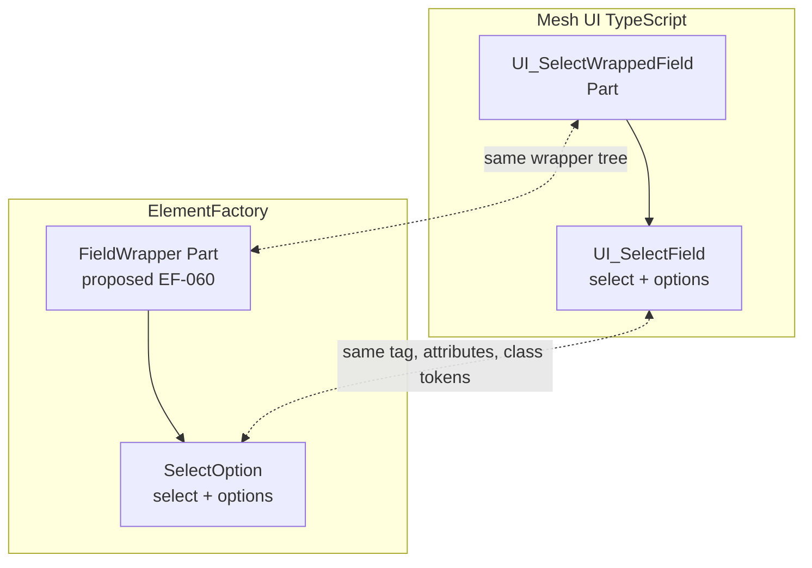

# AX ElementFactory and TypeScript Alignment

The ElementFactory (PHP) and the Mesh UI library (TypeScript, `C:\_src\app-mesh-ui`) are meant to produce the same DOM. EELC renders with PHP on the server; Storybook and downstream React consumers render with TypeScript. Both end up styled by the same CSS (`npm run build:eelc_css` writes `lab_center/css/lab.css`), so class tokens and element nesting are a shared contract, not a coincidence.

This document records what lines up today, what does not, and the order in which to close the gaps. Story IDs refer to the [backlog](../behavior/BV-element-factory-implementation-backlog.md).

## Two Granularities

| | PHP ElementFactory | Mesh UI TypeScript |
|---|---|---|
| Unit | One class per HTML element (140 enum tags) | One component per *Part* or *Module* (a composed wrapper) |
| Location | `src/Labs/MeshFactory/Element/{Domain}` | `src/library/Foundation/{Part,Module,Helper}` |
| Example | `InputText` renders `<input>` | `UI_TextInputWrappedField` renders `div.field-wrapper > label > div.field-inner-wrapper > input` |
| Naming | `Class` | `UI_{Name}` with `_StorybookComponent` for story wrappers |

The mismatch is the main alignment problem. A PHP `InputText` is the atom *inside* a TypeScript part. To produce the same DOM, PHP needs composite classes (Parts) above the element classes. This is `EF-060`.



## Inventory Map

TypeScript atoms below were read from `src/library/Foundation`. Status describes the PHP side.

| TypeScript atom | Exports | PHP counterpart | Status |
|---|---|---|---|
| `Part/Field` `Field.Input` | `UI_TextInputWrappedField`, `UI_EmailInputWrappedField`, `UI_PasswordInputWrappedField`, and wrapped fields for tel, number, url, hidden, submit, image, range, reset, search, button, checkbox, color, date, file, time, radio | `InputText`, `InputEmailer`, `InputPassword`, `InputHidden`, `InputRadio`, `FormButton` | 6 of 18 types. No wrapper (`EF-060`, `EF-023`). |
| `Part/Field` `Field.Select` | `UI_SelectWrappedField`, `UI_SelectField` | `SelectOption`, `SelectOptions` | Elements exist. No `multiple`, `disabled`, `optgroup`; string-key bug (`EF-024`, `EF-006`). |
| `Part/Field` `Field.Textarea` | `UI_TextareaWrappedField`, `UI_TextareaField` | none | Unbound (`EF-020`). |
| `Part/Field` `Fieldset.Collection` | `UI_FieldsetInputResolveFieldPart` | `Element\Form\Fieldset` | Aligned in name; label and class rendering delivered (`EF-047`). |
| `Part/Buttons` `Button.Generic` | `UI_Button_HtmlPart` | `Anchor` plus `InputButton` stub | No composite (`EF-064`). |
| `Part/Copy` `Copy.Paragraph` | `UI_GenericParagraph` | `P` | Element only, no `gen-para` token (`EF-065`). |
| `Part/Copy` `Copy.Header` | `h1`-`h6` | `H1`-`H6`, `Hl` | Element only. |
| `Part/Copy` `Copy.Lists` | `ul`, `ol`, `li` | `Ul`, `Ol`, `Li` | Element only. |
| `Part/Copy` `Copy.Images` | image blocks | `Img` | Element only, not sandboxed (`EF-050`). |
| `Part/Cards`, `Part/Headers`, `Part/Controls` | `div`-composed cards, header block, controls | `Div`, `Header`, `P`, `A` | Compose with elements; no named PHP parts. |
| `Module/Form` | `UI_FormModule` | `FormPost`, `FormAjax` | Attribute parity partial (`EF-063`). |
| `Module/Navigation` | `SocialNavigationMenu` | `Nav`, `Ul`, `Li`, `Anchor` | Compose with elements. |
| `Module/Accordion` | `UI_AccordionModule` family | `Details`, `Summary`, `Aside`, `Div` | Compose with elements. |
| `Module/Table` | style and script only; **no TSX** | `TableBody`, `DataTableBody`, `TableRow`, `TableHeader`, `TableCell` | PHP is ahead (`EF-061`). |
| `Helper` `UI_WrappedFieldLabel` | label plus tooltip | `getElementFieldLabelOpen()` | No tooltip (`EF-060`). |

## DOM Contracts (reference trees)

These are the trees the two sides must agree on. TypeScript is the source for field parts; PHP is the source for tables.

### Select field part

TypeScript (`Field.Select.part.tsx`):

```html
<div class="field-wrapper select {styleClass}" data-field="{name|id}">
  <label>
    {label + tooltip}
    <div class="field-inner-wrapper">
      <select class="field_ui {fieldStyleClass}" id="{id}" name="{name|id}" [multiple]>
        <option value="{value}" [disabled]>{text}</option>
      </select>
      <div class="clear"></div>
    </div>
  </label>
  <div class="clear"></div>
</div>
```

PHP today (`SelectOption::compileAsHtmlString()`):

```html
<select class="field_ui" name="qty" value="2"><option class="field_ui" value="1">One</option>...</select>
```

Differences to close: wrapper tree and `data-field`; `id`; options carry `field_ui` in PHP but not in TypeScript; `value` on the select; `multiple`; option `disabled`.

### Button part

TypeScript (`Button.Generic.part.tsx`):

```html
<div id="{id}" class="html-button {styleButtonClass|default-button}">
  <div class="button-wrapper"><a href="{href}" title="{title}" target="{target|_self}">{text}</a></div>
  <div class="clear"></div>
</div>
```

PHP today: `Anchor` renders only `<a class="generic-a" href target>`.

### Paragraph part

TypeScript: `<p class="{styleClass|gen-para}">{content}</p>` and nothing when content is empty. PHP `P` renders `<p></p>` for empty content and has no default class.

### Form module

TypeScript (`Form.module.tsx`):

```html
<section id="{id}" class="form {styleClass}">
  <div class="post_wrapper"><div class="form_wrapper">
    <form id name class action enctype method target>...</form>
    <div class="clear"></div>
  </div></div>
  <div class="clear"></div>
</section>
```

PHP `FormPost` renders the `<form>` only and defaults `autocomplete="off"`.

### Table

PHP (reference): `table.generic-table > thead.generic-thead > tr.generic-tr > th.generic-th > div.content`, `tbody.generic-tbody > tr.generic-tr > td.generic-cell > div.content`, `tfoot.generic-footer`.

TypeScript: none yet. The module's SCSS and script exist; a `_type/Table.module.tsx` should adopt this tree.

## Shared Class Tokens

| Token | Meaning | PHP source | TypeScript source |
|---|---|---|---|
| `field_ui` | The control itself | `$FactoryElementSystemClass = 'field_ui'` on field classes | Select, textarea, input fields |
| `field-wrapper`, `field-inner-wrapper`, `clear` | Field wrapper tree | missing | Field parts |
| `generic-*` | Table and anchor defaults | `generic-table`, `generic-thead`, `generic-tr`, `generic-th`, `generic-cell`, `generic-tbody`, `generic-footer`, `generic-a`, `generic-fieldset` | none |
| `post-form`, `ajax-form`, `post` | Form variants and submit button | `FormPost`, `FormAjax`, `FormButton` | none |
| `html-button`, `button-wrapper`, `gen-para` | Button and paragraph parts | missing | Button, paragraph |

Rule: a token that styles a component must exist on both sides or be documented as server-only.

## Property Map

| Concept | TypeScript | PHP |
|---|---|---|
| Element id | `id` | `id` |
| Wrapper class | `styleClass` | `class` / `addClass()` |
| Field name | `partFieldMeta.name` | `name` |
| Field label and tooltip | `partFieldMeta.label`, `.tooltip` | `addLabel()` (param ignored, `EF-004`); no tooltip |
| Control class | `partFieldMeta.fieldStyleClass` | `$FactoryElementSystemClass` / `addClass()` |
| Placeholder | `partFieldMeta.placeholder` | `placeholder` (`InputText`) |
| Default value | `partFieldMeta.defaultValue`, `.value` | `value` |
| Select options | `partFieldMeta.options[{value,text,disabled}]` | `addOptions([value => text])` |
| Multiple | `partFieldMeta.multiple` | none (`EF-024`) |
| Textarea size | `cols`, `rows`, `wrap` | none (`EF-020`) |
| Field type | `fieldType: UI_Field_InputType_Enum` | `FactoryElementFieldType` |
| Form id, name, class | `moduleMeta.formId`, `.formName`, `.formStyleClass` | `id`, `name` (ignored), `class` |
| Form action, method, enctype, target | `moduleMeta.formAction`, `.formMethod`, `.formEnctype`, `.formTarget` | `addAction`, `addMethod`, `addEnc`, `addTarget` |
| Button | `href`, `title`, `target`, `text`, `styleButtonClass` | `Anchor`: `href`, `title`, `target`, `content` |

## Enum Parity

`UI_Field_InputType_Enum` (23 values) versus `FactoryElementFieldType` (7):

| In both | TypeScript only |
|---|---|
| `text`, `email`, `password`, `hidden`, `radio`, `button`, `submit` | `tel`, `number`, `url`, `image`, `range`, `reset`, `search`, `checkbox`, `color`, `date`, `file`, `time`, `select`, `option`, `radio-group`, `textarea` |

`select`, `option`, `radio-group`, and `textarea` are element or composite kinds rather than input types; PHP expresses them as classes. The 12 remaining input types (`tel`, `number`, `url`, `image`, `range`, `reset`, `search`, `checkbox`, `color`, `date`, `file`, `time`) are `EF-023`.

## Proposed Alignment Workflow

1. **Golden fixtures** (`EF-062`). A fixture is a JSON file with the inputs for both languages and one expected HTML string:

   ```json
   {
     "id": "field.select.basic",
     "php": { "class": "MvpLounge\\MeshFactory\\Element\\Field\\SelectOption",
              "params": { "name": "qty", "value": 2 },
              "options": { "1": "One", "2": "Two" } },
     "ts":  { "component": "UI_SelectWrappedField",
              "props": { "id": "qty", "partFieldMeta": { "name": "qty", "options": [
                { "value": 1, "text": "One" }, { "value": 2, "text": "Two" } ] } } },
     "expectedHtml": "<div class=\"field-wrapper select\" ...>...</div>"
   }
   ```

   Store fixtures in one location that both repositories read (a folder in `app-mesh-ui`, copied or referenced by the MeshFactory sandbox). PHP asserts `string()` equals `expectedHtml`; Storybook tests assert `renderToStaticMarkup()` equals it.
2. **Pilot order**, smallest tree first: paragraph (`EF-065`), button (`EF-064`), select (`EF-060`, `EF-024`, `EF-006`), text input and textarea (`EF-020`, `EF-023`), form module (`EF-063`), table (`EF-061`).
3. **Contract changes** go through both repositories' documentation: a new token or tree change updates this document, the `AX` docs in `app-mesh-ui`, and the fixture.
4. **EELC adoption** follows once a part exists in PHP: replace the hand-built HTML in `Field.php`, `Form.php`, and `Table.php` with the part's `string()` (`EF-073`).

## Naming Rules To Keep Consistent

- TypeScript story wrappers end in `_StorybookComponent` and live in `.storybook` files; implementations live in `_type/*.part.tsx` or `*.module.tsx`.
- PHP composites should be named for the part (`FieldWrapper`, `ButtonPart`, `ParagraphPart`) and live in `Element/Form` or a new `Element/Part` domain, extending the nearest family abstract.
- Do not copy TypeScript `UI_` prefixes into PHP class names.
